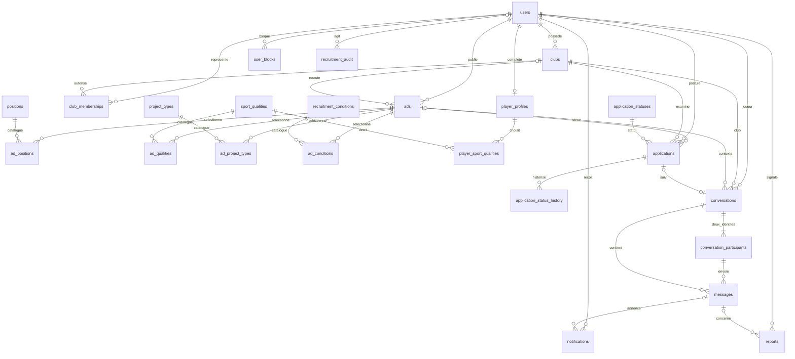

# Recrutement et messagerie MercaSport

## Ce qui a été réutilisé

L’audit du dépôt et des métadonnées Neon a confirmé Express 5, PostgreSQL, `pg`, les sessions existantes (`authentication/session.js`), `users`, `clubs`, `player_profiles`, `club_profiles`, `ads`, `ad_positions`, `applications`, les 14 `positions` et les 14 `divisions`. Les comptes, mots de passe et CV ne sont pas recréés. La vérification des joueurs, déjà présente dans Neon, reste indépendante de ce module.

Le préfixe `mercasport_` du cahier des charges n’est pas repris : doubler `ads`, `applications` ou les CV aurait créé deux sources de vérité. Les nouvelles tables reprennent les conventions existantes. Les références utilisent leurs codes comme clés primaires plutôt que des identifiants numériques inutiles.

Les anciennes annonces gardent leurs données et leurs limites. `recruitment_version=2` identifie le nouveau contrat facultatif. Les anciennes candidatures anonymes sont conservées ; elles ne sont jamais rattachées automatiquement à un compte par rapprochement d’e-mail.

## Parcours

- Un joueur peut rechercher un club dans Messages → Nouveau contact, sans fiche sportive ni annonce.
- Un représentant peut rechercher un pseudo joueur, choisir son club et écrire directement.
- Dans Mercato, un joueur peut postuler à une offre club ou simplement contacter le club. Le club peut contacter l’auteur d’une annonce joueur.
- Une candidature réutilise une conversation par contexte d’annonce et crée un historique de statut. Une candidature retirée peut être renvoyée sans créer une deuxième ligne.
- Le CV reste privé par défaut. Le joueur peut le publier pour les utilisateurs connectés ou le partager uniquement avec un club depuis une conversation. Les coordonnées suivent toujours les réglages `email_visible`, `phone_visible`, `location_visible` du compte.

## Schéma relationnel

Références supplémentaires : `sports`, `availability_options`, `mobility_options`, `sport_categories`, `recruitment_types`, `announcement_types`, `announcement_statuses`, `notification_types`, `report_reasons`, `report_statuses`, `preferred_feet`. Toutes les valeurs des nouveaux sélecteurs viennent de SQL via `/recruitment/options`.

`ads` reçoit type, références facultatives, publication/expiration/mise à jour et poste principal. Le titre et l’ancien `position` restent techniquement requis par le schéma historique : l’API génère un titre à partir du nom et utilise « Non précisé » si aucun poste n’est choisi. Aucun détail sportif n’est rendu obligatoire.

`applications` reçoit `player_user_id`, `club_id`, `status_code`, `updated_at`, `withdrawn_at`. Les valeurs restent nulles pour les candidatures historiques. L’index unique `(player_user_id, ad_id)` protège les candidatures authentifiées.

`player_profiles` reçoit disponibilités, sport, ville sportive explicitement partagée, saison, statistiques JSON validées, visibilité et version de contrat. Les qualités sont liées par `player_sport_qualities`, sans second CV.

## Contraintes et concurrence

- Conversation unique par `(player_user_id, club_id, context_key)`. La clé de contexte reste stable même si l’annonce est définitivement supprimée.
- Exactement deux identités actives, contrôlées par des triggers différés : une identité joueur et une identité club. Pas de route permettant d’ajouter un tiers.
- Le propriétaire représente l’identité club ; ses représentants actifs peuvent agir pour elle. Leur identité réelle est enregistrée dans `sent_by_user_id`. Lecture et archivage sont partagés par les représentants de ce club.
- Clé étrangère composée `(sender_participant_id, conversation_id)` ; trigger SQL vérifiant l’acteur, les comptes actifs et les blocages.
- Texte non vide, 4 000 caractères maximum ; UUID client unique par participant pour les reprises d’envoi sans doublon.
- Verrous de lignes et verrous consultatifs transactionnels pour la création de conversation et de candidature ; aucune écriture partielle en cas d’échec.
- Triggers différés sur les sélections, avec verrou du parent : annonce joueur 2 postes, club 3 postes, 5 qualités, 3 projets ou conditions ; CV 1 poste principal + 3 secondaires et 5 qualités par catégorie.
- Les anciennes fiches de plus de quatre postes ne sont pas tronquées. La nouvelle limite s’applique lors de leur modification dans le nouveau formulaire.
- Historique des candidatures enregistré par un trigger pour chaque changement ; l’acteur vient de la transaction serveur.
- Index pour les listes, les destinataires, les non-lus et les historiques. Pagination par curseur : 30 éléments par réponse, jamais tout l’historique d’un coup.

## API

Les URL utilisent les noms de ressources existants. Toutes les écritures exigent une session valide, un compte ACTIVE et l’origine exacte du site. Toutes les nouvelles routes privées renvoient `Cache-Control: no-store`.

| Méthode et route | Fonction / autorisation |
|---|---|
| GET `/recruitment/options` | Catalogues SQL publics, cache 5 minutes |
| GET `/ads?view=market` | Annonces publiées et non expirées ; filtres `type`, `sport`, `position`, `level`, `city`, `availability`, `before` |
| GET `/ads?view=market&owned=1` | Annonces du compte et des clubs représentés, session obligatoire |
| GET `/ads/:id?view=market` | Détail public, ou privé pour le propriétaire/représentant |
| POST `/ads` | Nouveau contrat si `announcement_type` est fourni ; sinon ancien formulaire conservé |
| PATCH `/ads/:id` | Champs partiels et statut, propriétaire/représentant uniquement |
| POST `/ads/:id/renew` | Publication pour 30 jours ; propriétaire/représentant |
| POST `/ads/:id/applications` | Candidature du joueur connecté ; `{message?, share_profile?}` |
| GET `/applications` | Candidatures du joueur et des clubs représentés |
| GET `/applications/:id` | Détail et historique, joueur concerné ou club autorisé |
| PATCH `/applications/:id` | `{status_code}`, transition et rôle contrôlés |
| GET `/messaging/identities` | Compte de session et clubs autorisés |
| GET `/contacts?q=...` | Nom de club ou pseudo, 2 caractères minimum ; jamais recherche d’e-mail |
| GET `/conversations` | Filtres `all`, `unread`, `players`, `clubs`, `applications`, `archived` ; curseur `before_time` + `before_id` |
| POST `/conversations` | `{club_id}` côté joueur ; `{as_club_id, player_user_id}` côté club ; `announcement_id?`, `share_profile?` |
| GET `/conversations/:id` | Contexte, interlocuteur, identité et candidature |
| PATCH `/conversations/:id` | `{archived?}`, ou `{share_profile?}` pour le joueur |
| GET `/conversations/:id/messages` | Historique avec `before` ou `after`, appartenance obligatoire |
| POST `/conversations/:id/messages` | `{message_body, client_nonce}` ; pas d’identifiant expéditeur fourni par le front |
| PATCH `/conversations/:id/read` | `{last_message_id}`, vérifié dans cette conversation |
| GET `/conversations/:id/profile` | Profil public du club ou CV autorisé du joueur |
| GET `/notifications` | Notifications du destinataire connecté, curseur `before` |
| PATCH `/notifications/:id` | Marquer sa propre notification lue, corps `{}` |
| GET / POST `/blocks` | Liste / ajout `{user_id}` pour le compte connecté |
| DELETE `/blocks/:id` | Retirer son blocage |
| POST `/reports` | `{conversation_id, message_id?, reason_code}` ; message reçu appartenant à la conversation |
| GET / PATCH `/sport-profile/me` | Lire / compléter sa fiche joueur existante |
| GET `/profiles/:id?conversation_id=...` | CV public ou explicitement partagé ; sinon résumé minimal |
| GET `/clubs/:id/public-profile` | Informations publiques du club |
| GET / PATCH `/admin/reports/:id` | Liste `/admin/reports`, traitement `{status_code}` par admin actif |
| GET / POST `/admin/club-memberships` | Admin : consulter/accorder/révoquer `{user_id, club_id, is_active}` |
| GET `/messaging/events` | Flux SSE authentifié, compte actif ; événements ciblés sans contenu de message |

Exemple nouvelle annonce : `{"announcement_type":"CLUB_SEARCH","club_id":3,"status":"PUBLISHED"}`. Tous les détails sont facultatifs. Champs possibles : `title`, `description`, `city`, `sport_code`, `availability_code`, `mobility_code`, `category_code`, `recruitment_type_code`, `division_code`, `preferred_foot_code`, `positions`, `primary_position`, `qualities`, `project_types`, `conditions`, `status`.

Statuts annonce : DRAFT, PUBLISHED, SUSPENDED, EXPIRED, CLOSED, ARCHIVED. DELETED reste accepté dans le catalogue pour lire l’historique existant, mais pas pour créer une nouvelle annonce. L’expiration est calculée à la lecture ; aucun cron n’est nécessaire.

Statuts candidature : SENT → VIEWED / DISCUSSING / TRIAL_PROPOSED / ACCEPTED / REJECTED ; TRIAL_PROPOSED → TRIAL_ACCEPTED par le joueur uniquement. Le joueur peut WITHDRAWN tant que le dossier n’est pas finalisé. Les états terminaux ne sont pas arbitrairement rouverts ; une candidature retirée peut être renvoyée sur une offre encore publiée. Un premier message de présentation du joueur ne compte pas comme une réponse du club. Le premier véritable échange avec le club passe les dossiers SENT/VIEWED en DISCUSSING.

Codes HTTP : 400 saisie/JSON invalide, 401 session absente/expirée, 403 droit/origine/compte inactif, 404 ressource absente ou étrangère, 409 doublon incompatible/transition impossible, 413 corps trop grand, 415 type de contenu, 429 limitation, 503 service indisponible. Les réponses d’erreur ne contiennent ni requête SQL ni secret.

## Sécurité

Le navigateur ne reçoit jamais DATABASE_URL ou AUTH_SECRET. Il envoie le cookie HttpOnly existant ; la session SQL, son expiration et le statut du compte sont revérifiés. Il n’y a pas de nouveau refresh token. Le rôle/identifiant des formulaires ne remplace jamais l’identité de session.

Les paramètres SQL utilisent `$1`, `$2`… Les rares noms de tables/colonnes dynamiques viennent d’une liste écrite dans le backend. Les corps JSON possèdent des listes de champs autorisés. Les accès aux conversations, candidatures et profils sont contrôlés à chaque requête, y compris dans le temps réel.

Les messages sont construits avec `textContent` / `createTextNode`, jamais injectés en HTML. Seuls les liens HTTP(S) sans identifiants intégrés deviennent cliquables, avec `noopener noreferrer nofollow`. Les avatars réutilisent les images existantes ; aucun upload n’est ajouté. Les dates de naissance complètes et les coordonnées privées ne sortent pas du CV partagé.

Limites SQL partagées entre instances : nouveaux contacts 15/10 min, messages 40/minute, candidatures 20/heure, publications 15/heure, signalements 10/heure. Elles complètent les contrôles métier ; elles ne remplacent pas une protection DDoS de l’hébergeur.

Un admin actif traite les signalements et les représentants. Un message reçu explicitement signalé peut lui être montré ; les autres messages de la conversation ne sont pas exposés par l’API de modération. Les actions sensibles laissent une trace sans copie du contenu privé.

PostgreSQL est joint exclusivement côté serveur avec les identifiants privés. Aucune API SQL publique, aucun Supabase/RLS inventé. Ce système n’offre pas de chiffrement de bout en bout : l’application peut lire les textes stockés pour les livrer aux participants autorisés.

## Réception en direct et coût

`messaging/realtime.js` utilise SSE HTTP et PostgreSQL LISTEN/NOTIFY. Un événement indique seulement qu’une conversation a changé. Le navigateur recharge les données via les API autorisées. Une coupure ne perd pas le message : SQL reste la source de vérité et la reconnexion relit les données.

Une connexion SQL dédiée par processus ayant des lecteurs, pas une connexion par utilisateur. Neon PgBouncer en mode transaction ne convient pas à LISTEN : le backend transforme uniquement le hostname Neon `-pooler` en hostname direct. Une variable privée `MESSAGING_DATABASE_URL` peut fournir explicitement une connexion directe TLS. Aucune désactivation des certificats.

Le flux est ouvert seulement sur Messages et lorsque l’onglet est visible. Il se ferme après 55 secondes puis se reconnecte ; un heartbeat revérifie la session toutes les 20 secondes. Limite de 2 flux par utilisateur et 64 par processus. Après plusieurs échecs, le front propose le mode manuel. Pas de requêtes de polling en arrière-plan, ni Redis, Pusher, Ably ou nouvel abonnement.

Le gratuit n’est pas illimité : les quotas de calcul/stockage Neon et de fonctions/transfert Vercel continuent de s’appliquer. Un onglet de discussion actif peut garder le calcul Neon éveillé ; le bouton « En direct » permet de passer en mode manuel. Aucun plan payant ni achat n’est activé par ce code. La durée maximale des fonctions Vercel doit permettre le flux de 55 secondes ; si le plan/projet le limite, le mode manuel reste fonctionnel. Voir [Streaming Functions](https://vercel.com/docs/functions/streaming-functions).

## Conservation et suppression

La suppression définitive d’un compte ou d’une annonce continue de passer par les routes admin existantes. Les nouvelles dépendances utilisent CASCADE ou SET NULL selon leur sens. Supprimer une annonce conserve les conversations, en retirant leur contexte d’annonce/candidature ; supprimer un joueur/club retire les discussions liées et leurs messages. Archiver une discussion masque l’identité concernée ; ce n’est pas un DELETE.

Politique technique proposée : messages et audit 365 jours, notifications lues 90 jours ou anciennes de 365 jours, signalements résolus 365 jours. Les messages liés à un signalement OPEN ne sont pas purgés. Valider cette durée et l’information des utilisateurs avant ouverture au public.

`npm run messaging:cleanup` affiche seulement les nombres éligibles. `npm run messaging:cleanup -- --apply` effectue un lot de 1 000 suppressions par table en transaction. Pas d’automatisation payante, pas de purge exécutée lors d’un build ou d’un démarrage. Répéter manuellement les lots si nécessaire. Les candidatures ne sont pas effacées automatiquement ; leurs FK suivent l’annonce et le compte.

## Déploiement et retour arrière

1. Sauvegarder la base avec `pg_dump` dans un dossier privé hors Git ; vérifier que l’archive peut être lue et que la restauration a été testée sur une base isolée.
2. Sur une base existante déjà à jour, appliquer **uniquement** `database/migrations/20261019-messaging-up.sql`. Le fichier ouvre et valide sa propre transaction et attend au maximum 5 secondes pour un verrou. Ne pas rejouer `schema.sql`, `seed.sql` ou toutes les anciennes migrations sur Neon.
3. Comparer les nombres et données des comptes, clubs, fiches, annonces et candidatures avant/après. La migration crée les références et les membres propriétaires, sans inventer de comptes.
4. Garder DATABASE_URL, AUTH_SECRET, APP_ORIGIN dans les variables privées existantes ; APP_ORIGIN doit être l’origine HTTPS exacte du site. MESSAGING_DATABASE_URL est facultative. Ne jamais publier ces valeurs.
5. `npm ci`, `npm run build` puis déployer. Le build copie seulement `frontend/` vers `public/` ; il ne migre jamais la base.
6. Vérifier les anciens parcours, les catalogues, un échange joueur/club avec deux navigateurs, l’archivage, le partage CV, une candidature et un accès tiers refusé.

Le fichier `20261019-messaging-down.sql` restaure les anciennes fonctions et contraintes et enlève le module **uniquement si aucune nouvelle donnée métier ne risque d’être perdue**. Après usage réel, il refuse volontairement le retour arrière destructeur : conserver les données et préparer une migration corrective, ou restaurer une sauvegarde dans une base séparée. Ne jamais contourner cette garde pour un simple souci de CSS.

## Vérification reproductible

`npm run test:messaging` : API et contraintes PostgreSQL embarquées jetables, aucune connexion Neon. `npm run test:messaging:live` : vrai PostgreSQL natif jetable, migration répétée, retour arrière, réception SSE entre deux instances et envois concurrents. Linux : outils PostgreSQL dans PATH ; Windows : définir PG_BIN sur les binaires PostgreSQL puis lancer le script Python. Ne charger aucun .env de production pour ces tests.

Les tests historiques restent séparés et doivent être lancés avec `--test-concurrency=1` sur une machine peu dotée en mémoire. La recette navigateur utilise uniquement les comptes synthétiques du serveur de test. Aucun mot de passe de démonstration ni donnée de production n’est nécessaire.

Fichiers à lire : `backend/messaging/` (identités, conversations, profils, direct, contrôles), `backend/recruitment/` (annonces, candidatures, modération), `frontend/js/recruitment-ui.mjs` et les modules de pages, `frontend/css/style-recruitment.css`, `database/migrations/20261019-messaging-*.sql`.
